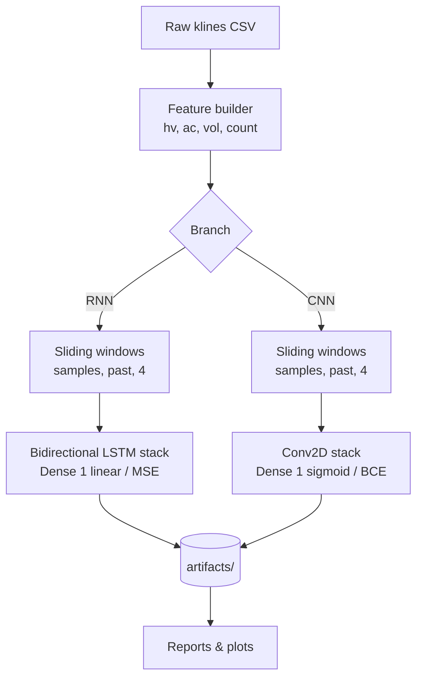
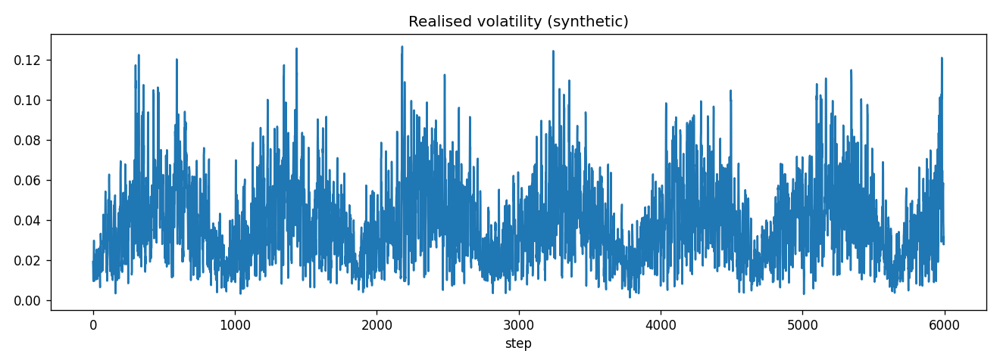
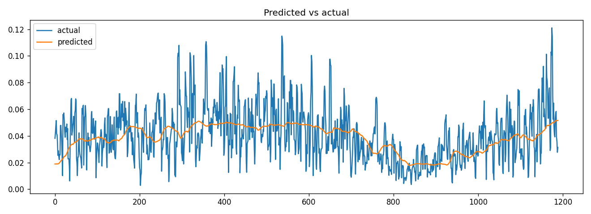
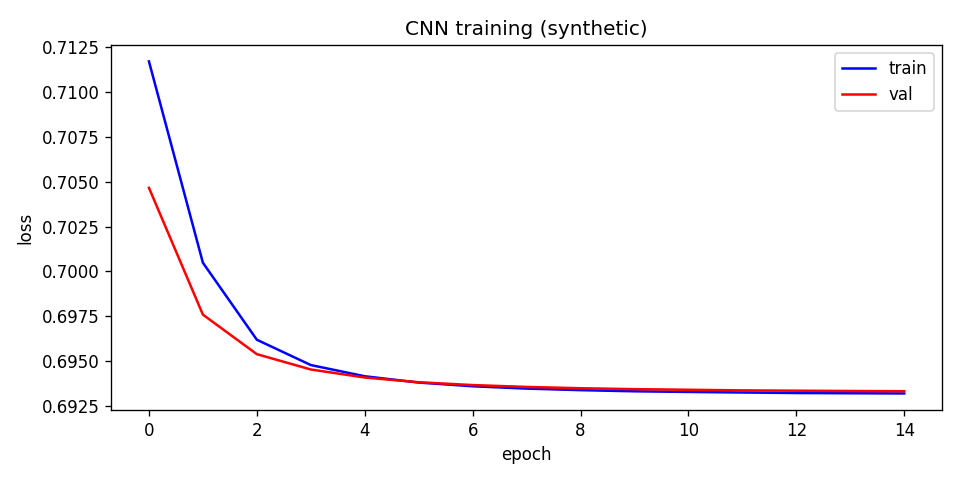
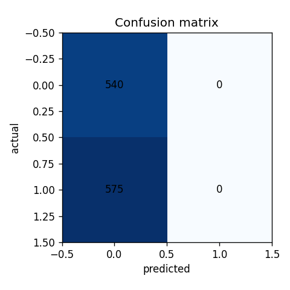
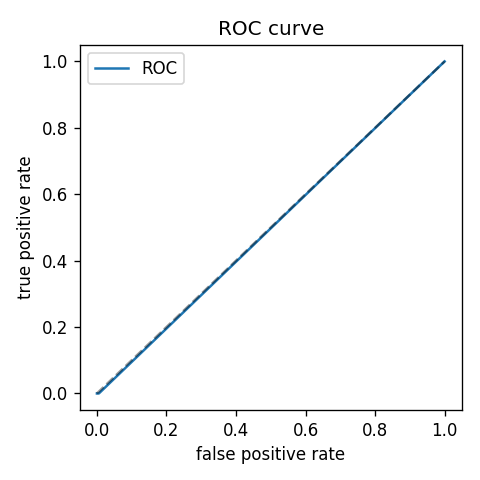

# market-volatility-nn

[](https://github.com/YZoZ/market-volatility-nn/actions/workflows/ci.yml)
[](https://www.python.org/)
[](LICENSE)
[](https://github.com/astral-sh/ruff)

Deep learning for **cryptocurrency volatility forecasting**. The project provides
two independent neural-network branches that operate on the same engineered
feature set:

- **RNN branch — regression:** a stacked (bidirectional) LSTM that forecasts the
  *future value* of realised volatility.
- **CNN branch — classification:** a Conv2D network that predicts the *direction*
  of the next volatility move (up / down) beyond a configurable threshold.

> **Disclaimer:** this is research software for educational and portfolio
> purposes. It is **not financial advice** and must not be used to make trading
> decisions.

---

## Contents

- [Motivation](#motivation)
- [Architecture](#architecture)
- [Quickstart](#quickstart)
- [Project structure](#project-structure)
- [Configuration](#configuration)
- [Results](#results)
- [Development](#development)
- [License](#license)

---

## Motivation

Predicting *volatility* is often more tractable than predicting raw price. This
project studies two complementary questions on the same volatility feature set:

1. **How large** will the realised volatility be over the next horizon? → regression
2. **In which direction** will it move? → binary classification

Both branches share the data pipeline, so they can be compared fairly.

### Target and features

The target is **annualised realised volatility** `hv`, computed from close prices:

```
returns = log(price_t / price_{t-1})
hv      = std(returns, window=w) * sqrt(365)
```

Each sample is a sliding window of `past` timesteps with **4 features**:

| Feature | Meaning |
|---|---|
| `hv` | realised volatility |
| `ac` | taker buy base-asset volume |
| `vol` | base-asset volume |
| `count` | number of trades |

---

## Architecture



- **RNN:** `BiLSTM(128) → LSTM(128) → LSTM(64) → LSTM(32) → Dense(32) → Dense(1)`.
- **CNN:** `Conv2D(32→32→64→64→128→128→256→512) → Flatten → Dense(1024) → Dense(1)`.

## Example output

These figures are produced by `volnn demo`/`docs/make_figures.py` on **synthetic
data** — they illustrate the pipeline, not real predictive performance.



| RNN — predicted vs actual | CNN — loss curves |
|---|---|
|  |  |

| CNN — confusion matrix | CNN — ROC curve |
|---|---|
|  |  |

---

## Quickstart

### 1. Install

```bash
git clone <your-repo-url>
cd market-volatility-nn
pip install -e ".[dev]"
```

### 2. Try it instantly (no data, no GPU)

```bash
volnn demo          # or: make demo
```

This generates synthetic market data and runs prepare → train → report in a
couple of minutes on CPU, writing artefacts to `artifacts/`.

### 3. Run on real market data

```bash
pip install -e ".[data,viz]"
volnn download --ticker BTCUSDT --interval 5m   # fetch historical klines
volnn prepare  --model rnn                       # build features + labels
volnn train    --model rnn                       # train + save artefacts
volnn predict  --model rnn                       # evaluate + metrics report
```

For the CNN branch use `--model cnn`.

### 4. Optional: streaming inference

Copy `.env.example` to `.env`, fill in your InfluxDB settings, then:

```bash
volnn live
```

---

## Project structure

```
market-volatility-nn/
├── src/volnn/
│   ├── cli.py            # Typer CLI (entry point: `volnn`)
│   ├── config.py         # dataclass config + env/YAML loading
│   ├── data/             # download, aggregation, features, labels, synthetic
│   ├── models/           # builders, RNN and CNN train/eval
│   ├── utils/            # io, scaling, sliding windows
│   ├── baselines.py      # persistence / majority / logistic regression
│   ├── train.py          # unified training entry
│   ├── predict.py        # evaluation + report
│   ├── live.py           # streaming inference (optional)
│   └── viz.py            # plots and reports
├── tests/                # pytest suite (no training, no network)
├── notebooks/01_eda.ipynb        # exploratory data analysis
├── notebooks/02_training.ipynb   # train both branches on synthetic data
├── docs/RELEASE_v1.0.0.md
├── docs/images/          # figures used in this README
├── docs/make_figures.py  # regenerates docs/images/
├── .github/workflows/ci.yml
├── Makefile
├── pyproject.toml
└── requirements.txt
```

---

## Configuration

Configuration is layered (defaults → YAML → environment → CLI). Pass a YAML file
with `--config`:

```yaml
features:
  ticker: BTCUSDT
  interval: 5m
  past: 288
  future: 24
  vol_window: 4
train:
  model: rnn
  epochs: 1000
  batch_size: 256
```

Secrets (InfluxDB credentials for `volnn live`) are read **only** from the
environment; see `.env.example`.

---

## Results

> The table below is a template. Fill it with your own numbers after training on
> real data; the values shown are illustrative placeholders.

### RNN — realised-volatility regression

| Model | MAE | RMSE |
|---|---|---|
| Naive persistence (baseline) | _TBD_ | _TBD_ |
| Bidirectional LSTM | _TBD_ | _TBD_ |

### CNN — direction classification

| Model | Accuracy | Precision | Recall | ROC-AUC |
|---|---|---|---|---|
| Majority class (baseline) | _TBD_ | _TBD_ | _TBD_ | _TBD_ |
| Logistic regression (baseline) | _TBD_ | _TBD_ | _TBD_ | _TBD_ |
| Conv2D network | _TBD_ | _TBD_ | _TBD_ | _TBD_ |

Plots (loss curves, predicted-vs-actual, confusion matrix, ROC) are written to
`artifacts/reports/`.

---

## Development

```bash
make setup     # install with dev extras
make lint      # ruff check + format check
make test      # pytest
make demo      # end-to-end synthetic pipeline
make clean     # remove generated data, artefacts and caches
```

CI runs `ruff` and `pytest` on Python 3.10 on every push and pull request. The
unit tests rely on synthetic data only and pass without a GPU or network access.

---

## License

Released under the [MIT License](LICENSE).
